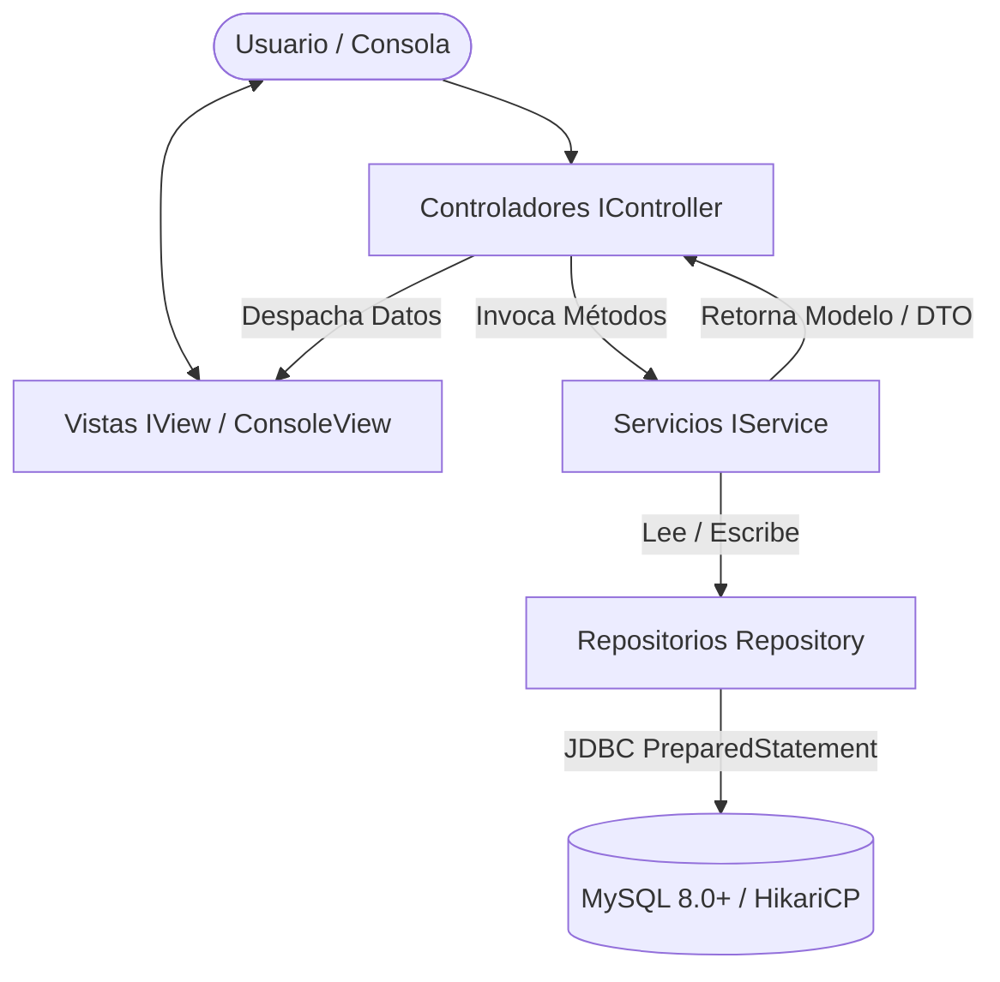

# Little Horizons ERP - Sistema de Gestión Educativa Integral


Sistema de Planificación de Recursos Empresariales (ERP) desarrollado para el **Colegio Internacional "Little Horizons"**, diseñado bajo rigurosos estándares de ingeniería de software, arquitectura limpia Modelo-Vista-Controlador (MVC) estrictamente desacoplada, 24 interfaces funcionales, aplicación exhaustiva de los Principios SOLID, patrones de diseño formales (DAO, Strategy, Factory, Singleton), procesamiento masivo con Java Stream API y emisión de facturación electrónica DIAN con CUFE y código QR bidimensional.

---

## 1. Título del Proyecto
**Little Horizons ERP (Enterprise Resource Planning Educativo)**  
*Sistema Centralizado de Gestión Académica, Extracurricular, Administrativa y Financiera.*

---

## 2. Descripción y Alcance del Sistema

### 2.1 Resumen del Propósito
El Colegio Internacional "Little Horizons" atiende a una comunidad de más de 500 estudiantes desde preescolar hasta grado 11°, con una nómina docente de más de 40 profesores y una variada oferta curricular y extracurricular. Este ERP actúa como el núcleo unificado que automatiza y centraliza la captura de datos, cálculo de calificaciones, cobros, facturación electrónica y préstamos de inventario.

### 2.2 Problemas que Resuelve
* **Pérdida de Información Académica:** Reemplaza planillas dispersas con persistencia transaccional relacional, cálculo automatizado de promedios ponderados y control de integridad referencial.
* **Control Extracurricular:** Control estricto de cupos máximos en clubes para evitar sobrecupos y seguimiento de premiaciones en eventos competitivos.
* **Facturación Electrónica DIAN:** Registro transaccional de pagos con emisión instantánea de factura en múltiples formatos (**PDF** con código QR y CUFE SHA-256, **TXT** plano estructurado para agentes y **XML UBL 2.1** bajo estándar MUISCA).
* **Trazabilidad de Recursos Escolares:** Seguimiento exhaustivo de préstamos y devoluciones de libros, microscopios, balanzas y tablets tanto para estudiantes como para profesores, con alertas funcionales de préstamos vencidos.
* **Tablero Ejecutivo y Alertas Tempranas:** Detección de inasistencias acumuladas y cartera morosa mediante consultas analíticas de Java Stream API.

---

## 3. Arquitectura de Software y Principios de Diseño

### 3.1 Arquitectura MVC Desacoplada (Separación Total de Responsabilidades)
El sistema implementa una separación estricta entre **Modelo**, **Vista** y **Controlador**:
* **Controladores (`controller`):** Cero acoplamiento con la interfaz de usuario (**0 llamadas a `System.out` o `System.err`** en todos los controladores). Su única responsabilidad es actuar como mediador entre los eventos de entrada, los servicios de negocio y las vistas.
* **Vistas (`view`):** Capa de presentación formal gobernada por interfaces (`IStudentView`, `IFinanceView`, `IAcademicView`, `ITeacherView`, `IExtracurricularView`, `IResourceView`, `IReportsView`, `IMainMenuView`). Las implementaciones en consola encapsulan el 100% de los elementos visuales, formateo de tablas, divisores y colores.
* **Modelo / Servicios (`service` / `model`):** Contiene la lógica de negocio, validaciones y transformaciones de dominio, totalmente agnóstico de la vista.



### 3.2 Aplicación Rigurosa de Principios SOLID

| Principio | Cómo se Aplica en Little Horizons ERP | Clases / Interfaces Clave |
| :--- | :--- | :--- |
| **S - Single Responsibility (Responsabilidad Única)** | Cada clase tiene un único motivo de cambio. Los controladores solo orquestan; las vistas solo imprimen; los servicios calculan reglas de negocio; los DAOs gestionan persistencia; `InvoiceContextResolver` centraliza la resolución de acudientes y estudiantes eliminando duplicidad. | `StudentController`, `StudentConsoleView`, `ReportsService`, `InvoiceContextResolver` |
| **O - Open/Closed (Abierto/Cerrado)** | El sistema está abierto a la extensión pero cerrado a la modificación. El motor de exportación de facturas permite incorporar nuevos formatos (ej: JSON, EDI) añadiendo implementaciones de `InvoiceExporter` sin tocar `FinanceService`. | `InvoiceExporter`, `PdfInvoiceExporter`, `TxtInvoiceExporter`, `XmlInvoiceExporter` |
| **L - Liskov Substitution (Sustitución de Liskov)** | Las implementaciones de interfaces (`StudentDAO` para `StudentRepository`, `FinanceConsoleView` para `IFinanceView`) son completamente intercambiables sin alterar la corrección del programa ni romper contratos. | `StudentRepository`, `PaymentRepository`, `IFinanceService` |
| **I - Interface Segregation (Segregación de Interfaces)** | Existen **24 interfaces granulares y específicas** en lugar de interfaces monolíticas. Los repositorios y vistas están estrictamente divididos por submódulo. | `IStudentView`, `IFinanceView`, `ClubRepository`, `PaymentRepository` |
| **D - Dependency Inversion (Inversión de Dependencias)** | Los módulos de alto nivel (Controladores y Servicios) dependen exclusivamente de abstracciones (interfaces), no de clases concretas. Se admiten constructores de inyección para máxima testabilidad. | `IAcademicService`, `IFinanceService`, `IResourceRepository`, etc. |

---

## 4. Patrones de Diseño Implementados y Justificación Técnica

### 4.1 Data Access Object (DAO) / Repository Pattern
* **Justificación:** Aislar la capa de persistencia relacional SQL del dominio educativo. Permite cambiar el motor o el esquema sin afectar la lógica de negocio.
* **Implementación:** 10 interfaces de repositorio (`StudentRepository`, `PaymentRepository`, `TeacherRepository`, etc.) implementadas por clases JDBC concretas (`StudentDAO`, `PaymentDAO`, etc.) que utilizan consultas preparadas seguras (`PreparedStatement`) y gestión determinista de conexiones con `try-with-resources`.

### 4.2 Strategy Pattern (Estrategia de Exportación de Facturas)
* **Justificación:** La DIAN y los sistemas de información requieren múltiples representaciones documentales para un mismo comprobante fiscal (PDF legible por humanos con QR, TXT estructurado para agentes de software y XML UBL 2.1 para la autoridad tributaria).
* **Implementación:** La interfaz `InvoiceExporter` define el contrato común. Las clases `PdfInvoiceExporter`, `TxtInvoiceExporter` y `XmlInvoiceExporter` encapsulan sus algoritmos de renderizado independientes.

### 4.3 Factory Pattern (Fábrica de Exportadores)
* **Justificación:** Desacoplar a `FinanceService` de la instanciación directa de las distintas estrategias de exportación.
* **Implementación:** `InvoiceExporterFactory` registra y suministra la instancia apropiada de `InvoiceExporter` según el formato solicitado (`PDF`, `TXT`, `XML`).

### 4.4 Singleton Pattern
* **Justificación:** Controlar centralizadamente recursos pesados y compartidos en tiempo de ejecución.
* **Implementación:** 
  * `DatabaseConfig`: Mantiene una única instancia del pool de conexiones `HikariDataSource`, evitando la sobrecarga de aperturas/cierres de sockets TCP.
  * `LoggerUtil`: Centraliza el buffer de escritura concurrente hacia `error_log.txt`.

---

## 5. Catálogo de Procesamiento Funcional (Java Stream API y Lambdas)

El proyecto pasó de un uso elemental a **más de 40 operaciones funcionales avanzadas** sobre colecciones y registros de dominio:

1. **Cuadro de Honor y Ranking Ponderado (`getHonorRoll`):**
   Filtra estudiantes activos, calcula sus promedios ponderados y los ordena descendentemente con `Comparator.comparingDouble(...).reversed()`.
2. **Distribución Cualitativa de Calificaciones (`getGradeDistribution`):**
   Agrupa notas en rangos institucionales ("Sobresaliente", "Alto", "Básico", "Bajo") mediante `Collectors.groupingBy` y `Collectors.counting()`.
3. **Estadísticas Descriptivas de Desempeño (`getSubjectPerformanceStatistics`):**
   Genera resúmenes estadísticos automáticos (`count`, `min`, `max`, `average`, `sum`) usando `mapToDouble(BigDecimal::doubleValue).summaryStatistics()`.
4. **Agregación Financiera por Medio de Pago (`getRevenueByPaymentMethod`):**
   Calcula totales recaudados por método (Efectivo, Transferencia, Tarjetas) empleando `Collectors.groupingBy` y `Collectors.reducing(BigDecimal.ZERO, ..., BigDecimal::add)`.
5. **Consolidado de IVA y Bases Gravables (`getTotalTaxCollected`, `getTotalTaxableBase`):**
   Reduce los importes tributarios de facturas electrónicas emitidas mediante pipelines de reducción funcional (`.reduce(BigDecimal.ZERO, BigDecimal::add)`).
6. **Particionamiento de Préstamos Vencidos (`partitionStudentLoansByOverdue`):**
   Divide de manera binaria los préstamos en activos y morosos respecto a la fecha actual con `Collectors.partitioningBy`.
7. **Monitoreo de Capacidad y Sobrecupo en Clubes (`getClubsNearCapacity`):**
   Filtra clubes cuya ocupación supera el umbral parametrizado (ej: 90%) evaluando `(enrolled / capacity)` funcionalmente.
8. **Tablero de KPIs Ejecutivos (`ReportsService`):**
   Consolida en tiempo real los 8 indicadores clave de la institución mediante Streams paralelos y secuenciales.

---

## 6. Estructura del Proyecto

```
src/
├── main/
│   ├── java/com/littlehorizons/erp/
│   │   ├── config/             // Configuración de pool HikariCP (Singleton)
│   │   ├── controller/         // Controladores puros (0 System.out, desacoplados)
│   │   │   ├── AcademicController.java
│   │   │   ├── ExtracurricularController.java
│   │   │   ├── FinanceController.java
│   │   │   ├── ReportsController.java
│   │   │   ├── ResourceController.java
│   │   │   ├── StudentController.java
│   │   │   └── TeacherController.java
│   │   ├── dao/                // Capa de persistencia (Interfaces de repositorio + JDBC DAOs)
│   │   │   ├── academic/       // StudentRepository, StudentDAO, etc.
│   │   │   ├── extracurricular/// ClubRepository, ClubDAO, EventRepository, EventDAO
│   │   │   ├── finance/        // PaymentRepository, PaymentDAO
│   │   │   └── resource/       // ResourceRepository, ResourceDAO
│   │   ├── model/              // Entidades de dominio encapsuladas
│   │   │   ├── academic/
│   │   │   ├── extracurricular/
│   │   │   ├── finance/
│   │   │   ├── report/         // ExecutiveKpiDashboard (Record)
│   │   │   └── resource/
│   │   ├── service/            // Lógica de negocio (IAcademicService, IFinanceService, etc.)
│   │   │   └── export/         // Strategy & Factory (InvoiceExporter, Factory)
│   │   ├── util/               // Utilidades (TaxCalculator, CufeGenerator, Resolver, Logger)
│   │   ├── view/               // Capa de vistas (IView interfaces + ConsoleViews con bordes Unicode)
│   │   └── Main.java           // Punto de entrada de la aplicación
│   └── resources/
│       └── database.properties // Parámetros HikariCP y MySQL
└── test/
    └── java/com/littlehorizons/erp/
        ├── CufeGeneratorTest.java          // Validación algoritmo SHA-256 DIAN
        ├── DatabaseConnectivityTest.java   // Verificación pool y persistencia MySQL
        ├── DataInputResilienceAuditTest.java// 56 pruebas de resiliencia y entradas
        ├── FullSystemIntegrationTest.java  // Flujo E2E pago -> factura PDF
        ├── InvoiceMultiFormatTaxTest.java  // Pruebas tributarias y multi-formato
        ├── InvoicePdfGenerationTest.java   // Generación física de PDF y QR
        ├── SecurityIntegrityAuditTest.java // Auditoría de código limpio y PreparedStatement
        ├── StreamCalculationTest.java      // Pruebas exhaustivas de Stream API y agrupaciones
        └── ValidationUtilTest.java         // Validación estricta de formato y rangos
```

---

## 7. Tecnologías y Librerías

* **Lenguaje:** Java 21 LTS / Java 27 (OpenJDK 64-Bit).
* **Gestor de Dependencias:** Apache Maven 3.9+.
* **Motor de Persistencia:** MySQL 8.0+ con motor transaccional InnoDB y restricciones `CHECK`.
* **Pool JDBC:** `com.zaxxer:HikariCP:5.1.0`.
* **Generación PDF:** `com.github.librepdf:openpdf:2.0.3`.
* **Códigos QR:** `com.google.zxing:core:3.5.3` y `javase:3.5.3`.
* **Pruebas Automatizadas:** JUnit 5 (`org.junit.jupiter:junit-jupiter:5.10.2`).

---

## 8. Configuración de Base de Datos

### 8.1 Creación y Datos de Prueba
El script maestro se encuentra en [`docs/database.sql`](docs/database.sql):
```bash
mysql -u root -p < docs/database.sql
```
Crea la base de datos `erp_little_horizons` con 22 tablas normalizadas, llaves foráneas y datos iniciales realistas para el contexto colombiano.

### 8.2 Parámetros de Conexión
Configurados en `src/main/resources/database.properties`:
```properties
db.url=jdbc:mysql://localhost:3306/erp_little_horizons?useSSL=false&allowPublicKeyRetrieval=true&serverTimezone=America/Bogota&characterEncoding=UTF-8
db.user=root
db.password=root
db.pool.maximumPoolSize=10
db.pool.minimumIdle=2
db.pool.idleTimeout=30000
db.pool.connectionTimeout=10000
```
*También es configurable mediante variables de entorno:* `DB_URL`, `DB_USER` y `DB_PASSWORD`.

---

## 9. Compilación y Ejecución de Pruebas

### 9.1 Compilar el Proyecto
```bash
mvn clean compile
```

### 9.2 Ejecutar la Suite de Pruebas Automatizadas (82 Tests)
```bash
mvn test
```
Ejecuta las pruebas unitarias, de integración, de resiliencia de entrada, cálculos funcionales y la auditoría de seguridad [`SecurityIntegrityAuditTest`](src/test/java/com/littlehorizons/erp/SecurityIntegrityAuditTest.java).

### 9.3 Ejecutar la Aplicación
```bash
# Fat JAR empaquetado:
mvn clean package
java -jar target/LittleHorizons-1.0-SNAPSHOT.jar

# O directamente con Maven Exec:
mvn compile exec:java -Dexec.mainClass="com.littlehorizons.erp.Main"
```

---

## 10. Seguridad y Cumplimiento de Auditoría
* **Prevención de Inyección SQL:** 100% de consultas construidas con `PreparedStatement` parametrizadas por posición (`?`).
* **Higiene de Recursos:** Cierre determinista de recursos JDBC y streams con `try-with-resources`.
* **Código de Producción Limpio:** Código 100% libre de comentarios residuales en `src/main/java`, verificado por prueba automatizada de expresión regular.
* **Estatuto Tributario Colombiano:** Cumplimiento de Art. 476 Num. 6 (servicios educativos excluidos de IVA) y Art. 468 (servicios y materiales gravados al 19%).

---

## 11. Autores y Licencia
* **Desarrollador Principal:** Juan Camilo Leal ([@Jlebot7](https://github.com/Jlebot7))
* **Institución:** Colegio Internacional Little Horizons S.A.S.
* **Licencia:** MIT License
