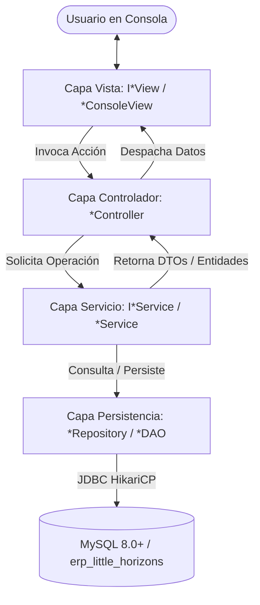

# Colegio Little Horizons - ERP de Gestión Educativa Integral

Sistema empresarial de gestión académica, administrativa y financiera desarrollado en **Java 21 (LTS)** con arquitectura **MVC desacoplada**, persistencia relacional con **MySQL 8.0+** y pool de conexiones de alto rendimiento con **HikariCP**.

---

## 1. Alcance y Capacidades del Sistema

* **Gestión Académica Completa:** Matrícula de estudiantes, registro de calificaciones (0.0 a 5.0), cálculo de promedios ponderados y control de inasistencias.
* **Control de Asistencia e Importación Masiva CSV:** Validación línea por línea independiente e importación automatizada desde archivos CSV (`asistencias_importar.csv`), junto con reportes analíticos consolidados exportables a formato `.txt`.
* **Facturación Electrónica DIAN:** Generación de facturas comerciales con IVA (19%), cálculo de CUFE normativo (SHA-256), código QR impreso y exportación en múltiples formatos (**PDF con OpenPDF**, **TXT estructurado** y **XML UBL 2.1**).
* **Gestión de Recursos y Biblioteca:** Préstamo y devolución de libros, control de inventario y estado de equipos de laboratorio.
* **Actividades Extracurriculares:** Gestión de clubes, control de cupos máximos y cronograma de eventos.
* **Auto-Bootstrapper de Base de Datos:** Auto-detección y verificación de conectividad al iniciar `Main`, levantamiento asistido e inicialización automática de esquema y tablas desde `docs/database.sql`.
* **Interfaz de Consola:** Experiencia enriquecida con marcos de doble línea Unicode, formateo monetario colombiano (`$ 1.250.000,00 COP`), validaciones resilientes a fallos y navegación jerárquica.

---

## 2. Instrucciones de Ejecución Rápida

### Requisitos Previos
* **Java Development Kit (JDK):** Versión 21 o superior (probado con OpenJDK 27).
* **Apache Maven:** 3.8+ (incluido con IntelliJ IDEA o instalado en el sistema).
* **Base de Datos:** MySQL Server 8.0+ (opcional: el sistema cuenta con auto-arranque e inicialización automática).

### Compilación y Ejecución
```bash
# Compilar y empaquetar el proyecto
mvn clean package -DskipTests

# Ejecutar la aplicación principal
java -jar target/LittleHorizons-1.0-SNAPSHOT.jar
```

O directamente mediante Maven:
```bash
mvn compile exec:java -Dexec.mainClass="com.littlehorizons.erp.Main"
```

---

## 3. Arquitectura y Principios de Diseño (SOLID)

### 3.1 Separación de Capas (MVC Puro y Desacoplado)
El proyecto implementa una separación estricta de responsabilidades donde los controladores no acceden directamente a `System.out` ni contienen lógica de presentación:



### 3.2 Aplicación Rigurosa de Principios SOLID

| Principio | Cómo se Aplica en Little Horizons ERP | Clases / Interfaces Clave |
| :--- | :--- | :--- |
| **S - Single Responsibility (Responsabilidad Única)** | Cada clase tiene un único motivo de cambio. Los controladores solo orquestan; las vistas solo imprimen; los servicios calculan reglas de negocio; los DAOs gestionan persistencia; `InvoiceContextResolver` centraliza la resolución de acudientes y estudiantes eliminando duplicidad. | `StudentController`, `StudentConsoleView`, `ReportsService`, `InvoiceContextResolver` |
| **O - Open/Closed (Abierto/Cerrado)** | El sistema está abierto a la extensión pero cerrado a la modificación. El motor de exportación de facturas permite incorporar nuevos formatos (ej: JSON, EDI) añadiendo implementaciones de `InvoiceExporter` sin tocar `FinanceService`. | `InvoiceExporter`, `PdfInvoiceExporter`, `TxtInvoiceExporter`, `XmlInvoiceExporter` |
| **L - Liskov Substitution (Sustitución de Liskov)** | Las implementaciones de interfaces (`StudentDAO` para `StudentRepository`, `FinanceConsoleView` para `IFinanceView`) son completamente intercambiables sin alterar la corrección del programa ni romper contratos. | `StudentRepository`, `PaymentRepository`, `IFinanceService` |
| **I - Interface Segregation (Segregación de Interfaces)** | Existen **26 interfaces granulares y específicas** en lugar de interfaces monolíticas. Los repositorios y vistas están estrictamente divididos por submódulo. | `IStudentView`, `IFinanceView`, `ClubRepository`, `IAttendanceReportService` |
| **D - Dependency Inversion (Inversión de Dependencias)** | Los módulos de alto nivel (Controladores y Servicios) dependen exclusivamente de abstracciones (interfaces), no de clases concretas. Se admiten constructores de inyección para máxima testabilidad. | `IAcademicService`, `IFinanceService`, `IResourceRepository`, `IDatabaseBootstrapService` |

---

## 4. Patrones de Diseño Implementados y Justificación Técnica

### 4.1 Data Access Object (DAO) / Repository Pattern
* **Justificación:** Aislar la capa de persistencia relacional SQL del dominio educativo. Permite cambiar el motor o el esquema sin afectar la lógica de negocio.
* **Implementación:** 10 interfaces de repositorio (`StudentRepository`, `PaymentRepository`, `TeacherRepository`, etc.) implementadas por clases JDBC concretas (`StudentDAO`, `PaymentDAO`, etc.) que utilizan consultas preparadas seguras (`PreparedStatement`) y gestión determinista de conexiones con `try-with-resources`.

### 4.2 Strategy Pattern (Estrategia de Exportación de Facturas)
* **Justificación:** La DIAN y los sistemas de información requieren múltiples representaciones documentales para un mismo comprobante fiscal (PDF con QR, TXT estructurado y XML UBL 2.1).
* **Implementación:** La interfaz `InvoiceExporter` define el contrato común. Las clases `PdfInvoiceExporter`, `TxtInvoiceExporter` y `XmlInvoiceExporter` encapsulan sus algoritmos de renderizado independientes.

### 4.3 Factory Pattern (Fábrica de Exportadores)
* **Justificación:** Desacoplar a `FinanceService` de la instanciación directa de las distintas estrategias de exportación.
* **Implementación:** `InvoiceExporterFactory` registra y suministra la instancia apropiada de `InvoiceExporter` según el formato solicitado (`PDF`, `TXT`, `XML`).

### 4.4 Singleton Pattern
* **Justificación:** Controlar centralizadamente recursos pesados y compartidos en tiempo de ejecución.
* **Implementación:** 
  * `DatabaseConfig`: Mantiene una única instancia del pool de conexiones `HikariDataSource`, evitando sobrecargas de sockets TCP.
  * `LoggerUtil`: Centraliza el buffer de escritura concurrente hacia `error_log.txt`.

### 4.5 Auto-Bootstrapper & Self-Healing Pattern (`DatabaseBootstrapService`)
* **Justificación:** Permitir que la aplicación levante y auto-repare su entorno de persistencia sin requerir pasos manuales de configuración.
* **Implementación:** `IDatabaseBootstrapService` y `DatabaseBootstrapService` detectan el estado de MySQL en `localhost:3306`, inician el servicio local en Windows si está detenido, y ejecutan de manera transaccional y controlada el script `docs/database.sql` si el esquema o tablas no existen.

---

## 5. Catálogo de Procesamiento Funcional (Java Stream API y Lambdas)

El proyecto cuenta con **más de 45 operaciones funcionales avanzadas** sobre colecciones y registros de dominio:

1. **Cuadro de Honor y Ranking Ponderado (`getHonorRoll`):**
   Filtra estudiantes activos, calcula sus promedios ponderados y los ordena descendentemente con `Comparator.comparingDouble(...).reversed()`.
2. **Distribución Cualitativa de Calificaciones (`getGradeDistribution`):**
   Agrupa notas en rangos institucionales ("Sobresaliente", "Alto", "Básico", "Bajo") mediante `Collectors.groupingBy` y `Collectors.counting()`.
3. **Estadísticas Descriptivas de Desempeño (`getSubjectPerformanceStatistics`):**
   Genera resúmenes estadísticos automáticos (`count`, `min`, `max`, `average`, `sum`) usando `mapToDouble(BigDecimal::doubleValue).summaryStatistics()`.
4. **Agregación Financiera por Medio de Pago (`getRevenueByPaymentMethod`):**
   Calcula totales recaudados por método (Efectivo, Transferencia, Tarjetas) empleando `Collectors.groupingBy` y `Collectors.reducing(BigDecimal.ZERO, ..., BigDecimal::add)`.
5. **Consolidado de IVA y Bases Gravables (`getTotalTaxCollected`, `getTotalTaxableBase`):**
   Reduce los importes tributarios de facturas electrónicas emitidas mediante pipelines de reducción funcional (`.reduce(BigDecimal.ZERO, BigDecimal::add)`).
6. **Particionamiento de Préstamos Vencidos (`partitionStudentLoansByOverdue`):**
   Divide de manera binaria los préstamos en activos y morosos respecto a la fecha actual con `Collectors.partitioningBy`.
7. **Monitoreo de Capacidad y Sobrecupo en Clubes (`getClubsNearCapacity`):**
   Filtra clubes cuya ocupación supera el umbral parametrizado (ej: 90%) evaluando `(enrolled / capacity)` funcionalmente.
8. **Tablero de KPIs Ejecutivos (`ReportsService`):**
   Consolida en tiempo real los 8 indicadores clave de la institución mediante Streams paralelos y secuenciales.
9. **Reporte Consolidado y Alertas de Asistencia (`AttendanceReportService`):**
   Agrupa asistencias por estudiante y materia con `Collectors.groupingBy`, calcula tasas de asistencia, ausencias, tardanzas y clasifica funcionalmente el estado de alerta crítica (< 75%), ordenando los resultados mediante comparadores compuestos (`comparingDouble(...).thenComparing(...)`) y exportando el reporte completo a archivo `.txt`.

---

## 6. Estructura del Proyecto

```
src/
├── main/
│   ├── java/com/littlehorizons/erp/
│   │   ├── config/             // Configuración de pool HikariCP (Singleton)
│   │   ├── controller/         // Controladores puros (0 System.out, desacoplados)
│   │   │   ├── AcademicController.java
│   │   │   ├── ExtracurricularController.java
│   │   │   ├── FinanceController.java
│   │   │   ├── ReportsController.java
│   │   │   ├── ResourceController.java
│   │   │   ├── StudentController.java
│   │   │   └── TeacherController.java
│   │   ├── dao/                // Capa de persistencia (Interfaces de repositorio + JDBC DAOs)
│   │   │   ├── academic/       // StudentRepository, AttendanceRepository, etc.
│   │   │   ├── extracurricular/// ClubRepository, EventRepository, etc.
│   │   │   ├── finance/        // PaymentRepository, PaymentDAO
│   │   │   └── resource/       // ResourceRepository, ResourceDAO
│   │   ├── model/              // Entidades de dominio y DTOs encapsulados
│   │   │   ├── academic/
│   │   │   ├── extracurricular/
│   │   │   ├── finance/
│   │   │   ├── report/         // ExecutiveKpiDashboard, AttendanceSummaryReport (Records)
│   │   │   └── resource/
│   │   ├── service/            // Lógica de negocio e interfaces (IAcademicService, IAttendanceReportService, etc.)
│   │   │   └── export/         // Strategy & Factory (InvoiceExporter, Factory)
│   │   ├── util/               // Utilidades (TaxCalculator, CufeGenerator, Resolver, Logger)
│   │   ├── view/               // Capa de vistas (IView interfaces + ConsoleViews con formato Unicode)
│   │   └── Main.java           // Auto-bootstrapper y punto de entrada de la aplicación
│   └── resources/
│       └── database.properties // Parámetros HikariCP y MySQL
└── test/
    └── java/com/littlehorizons/erp/
        ├── AttendanceImportServiceTest.java// Validación línea por línea CSV
        ├── AttendanceReportServiceTest.java// Métricas funcionales y exportación TXT
        ├── CufeGeneratorTest.java          // Validación algoritmo SHA-256 DIAN
        ├── DatabaseBootstrapServiceTest.java// Resiliencia y auto-arranque DB
        ├── DatabaseConnectivityTest.java   // Verificación pool y persistencia MySQL
        ├── DataInputResilienceAuditTest.java// 56 pruebas de resiliencia y entradas
        ├── FullSystemIntegrationTest.java  // Flujo E2E pago -> factura PDF
        ├── InvoiceMultiFormatTaxTest.java  // Pruebas tributarias y multi-formato
        ├── InvoicePdfGenerationTest.java   // Generación física de PDF y QR
        ├── SecurityIntegrityAuditTest.java // Cero comentarios en src/main/java y auditoría SQL
        ├── StreamCalculationTest.java      // Cobertura completa de operaciones Stream API
        └── ValidationUtilTest.java         // Reglas de negocio y formato colombiano
```

---

## 7. Verificación de Calidad y Pruebas

Para ejecutar la suite completa de 93 pruebas unitarias y de integración:

```bash
mvn test
```

### Políticas de Integridad Auditadas Automáticamente
1. **Cero Comentarios en Código de Producción:** Verificado por `SecurityIntegrityAuditTest.testZeroCommentsInMainSourceCode` sobre todas las clases de `src/main/java`.
2. **Prevención de Inyecciones SQL:** Verificado por `SecurityIntegrityAuditTest.testSqlInjectionPreventionInDAOs` (obligatoriedad de `PreparedStatement` y `try-with-resources`).
3. **Resiliencia ante Desconexión:** Si el motor de MySQL se encuentra fuera de línea, la aplicación y la suite de pruebas manejan el estado mediante supuestos controlados (`Assumptions.assumeTrue`) y registros informativos sin arrojar excepciones no controladas.
